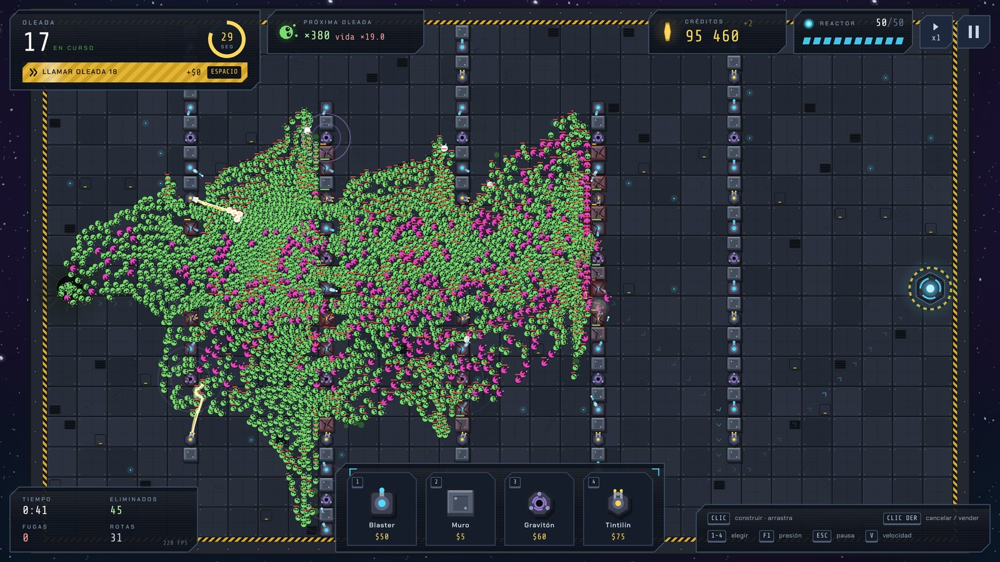
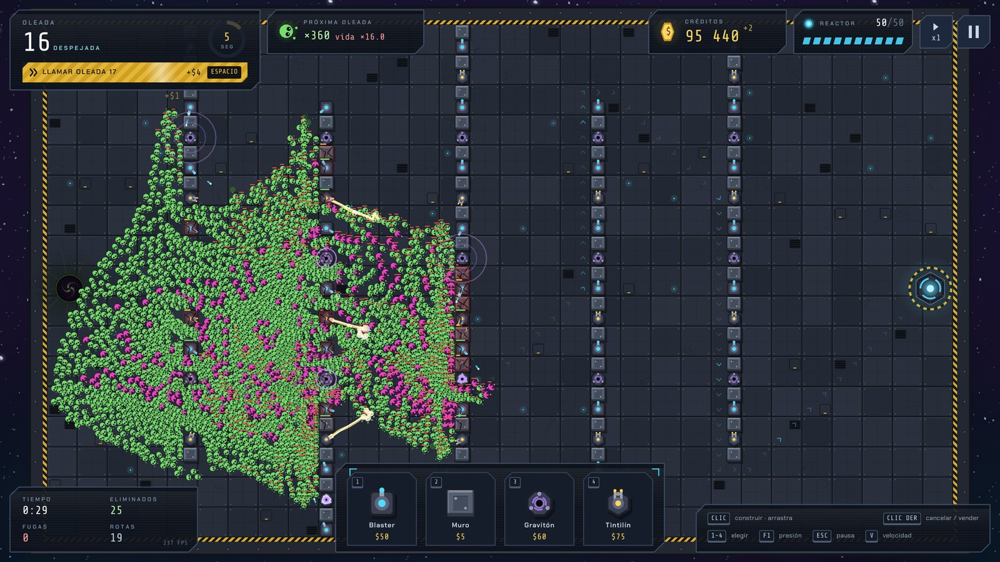
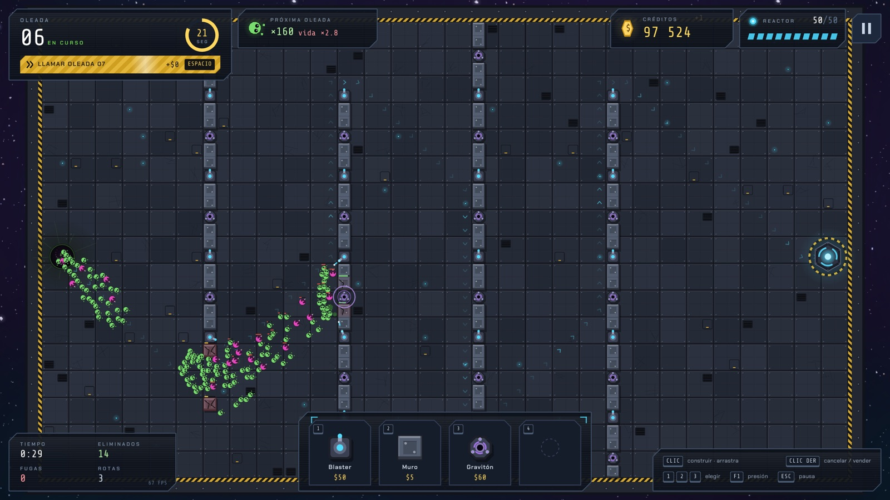
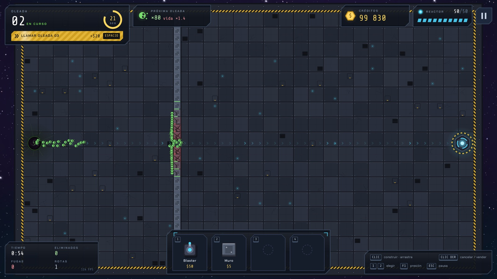
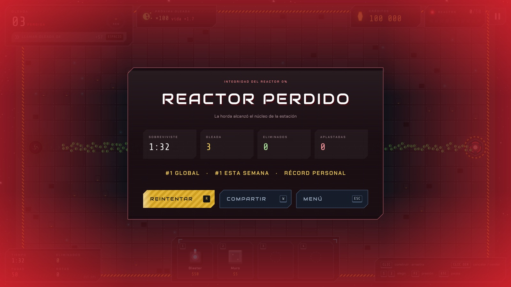
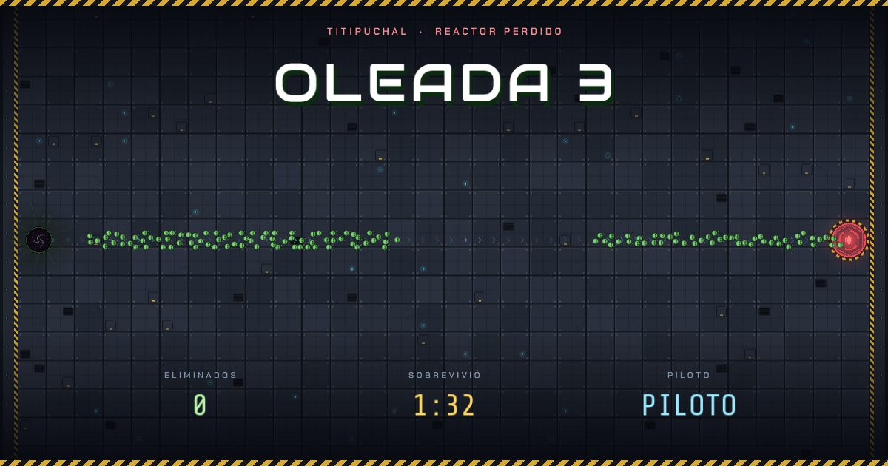
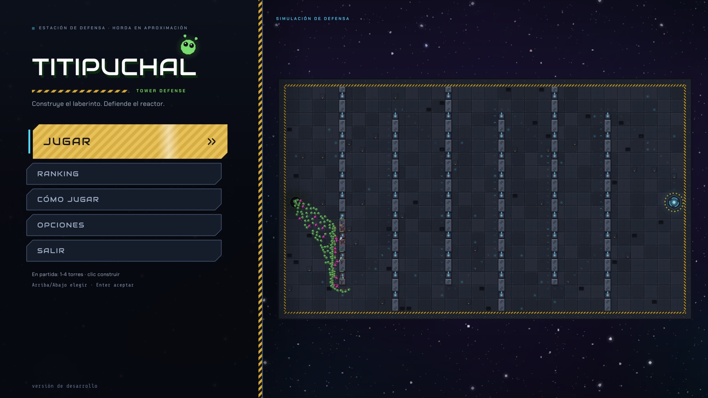

# Titipuchal

**Tower defense contra hordas de miles de aliens.** Construye tu propio laberinto de torres y muros en la cubierta de una estación espacial y defiende el reactor el mayor tiempo posible. Las oleadas no terminan nunca: compite en el ranking online y comparte tus partidas por WhatsApp.

  
  
  

Siempre la última versión · macOS: Apple Silicon (M1 o posterior) · el juego se actualiza solo

## Descargar

Los botones de arriba bajan siempre la última versión. Todas las versiones y sus notas: **[Releases](https://github.com/tavodev/titipuchal-releases/releases)**.

| Sistema | Archivo | Cómo abrirlo |
|---|---|---|
| Windows | [`Titipuchal-win-Setup.exe`](https://github.com/tavodev/titipuchal-releases/releases/latest/download/Titipuchal-win-Setup.exe) | Ejecútalo. Si aparece SmartScreen: *Más información → Ejecutar de todos modos*. |
| macOS (Apple Silicon, M1 o posterior) | [`Titipuchal-osx-Portable.zip`](https://github.com/tavodev/titipuchal-releases/releases/latest/download/Titipuchal-osx-Portable.zip) | Descomprime y abre `Titipuchal.app`. |
| Linux | [`Titipuchal.AppImage`](https://github.com/tavodev/titipuchal-releases/releases/latest/download/Titipuchal.AppImage) | `chmod +x Titipuchal.AppImage` y ábrelo. |

El juego se actualiza solo: cuando hay una versión nueva, el menú principal ofrece **Actualizar**.

## Cómo se juega

- **Construye donde quieras**: torres Blaster, Tintilines, Gravitones y muros en cualquier casilla libre. Los aliens recalculan su camino al instante, así que el laberinto lo diseñas tú.
- **Tintilín**: un láser que pega al instante y rebota entre cuatro aliens: ideal contra la horda apretada.
- **Gravitón**: no dispara, emite ondas gravitacionales que frenan a la horda para que pase más tiempo bajo el fuego de tus Blasters.
- **La horda empuja**: se mueve como un fluido y, si le cierras el paso, aplasta tus construcciones a la fuerza.
- **Marcianecos**: aliens más duros que se lanzan de cabeza contra los muros que tienen delante para abrirse paso por tu laberinto.
- **Oleadas infinitas**, cada vez más duras. Pulsa `Espacio` para llamar la siguiente antes y ganar créditos extra, y acelera la partida a ×2 o ×3 con `V`.
- **Ranking online** global y semanal (cada partida se vuelve a jugar en el servidor para comprobar que es real), y un botón para **compartir** tu partida por WhatsApp con una imagen de tu laberinto.

Al compartir por WhatsApp, tus amigos ven una tarjeta como esta con tu laberinto:

## Controles

| Acción | Tecla |
|---|---|
| Elegir Blaster / Muro / Gravitón / Tintilín | `1` / `2` / `3` / `4` o clic en el muelle |
| Construir (se puede arrastrar) | clic izquierdo |
| Vender (50 %) | clic derecho sobre la construcción |
| Llamar la siguiente oleada | `Espacio` |
| Acelerar la partida (×1 / ×2 / ×3) | `V` o el botón junto a la pausa |
| Zoom | rueda del ratón / trackpad (`F` encuadra el tablero) |
| Mover la cámara | `WASD` / flechas o botón central |
| Pausa | `Esc` / `P` |
| Compartir la partida (tras perder) | `W` |
